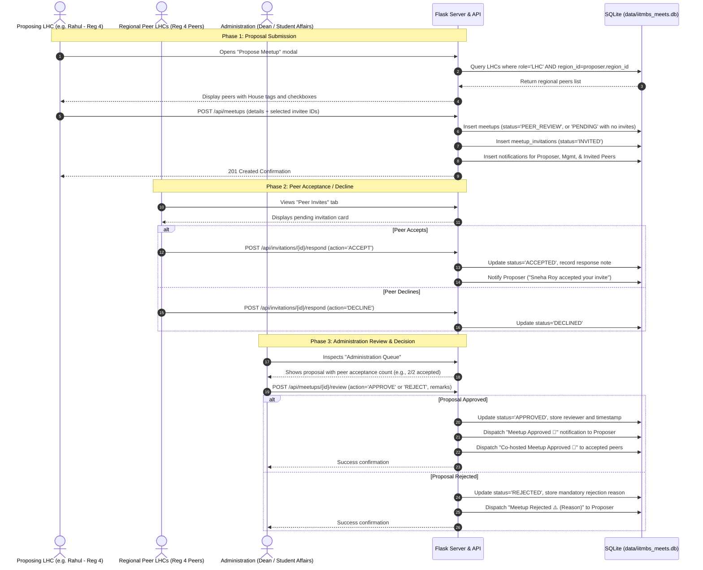
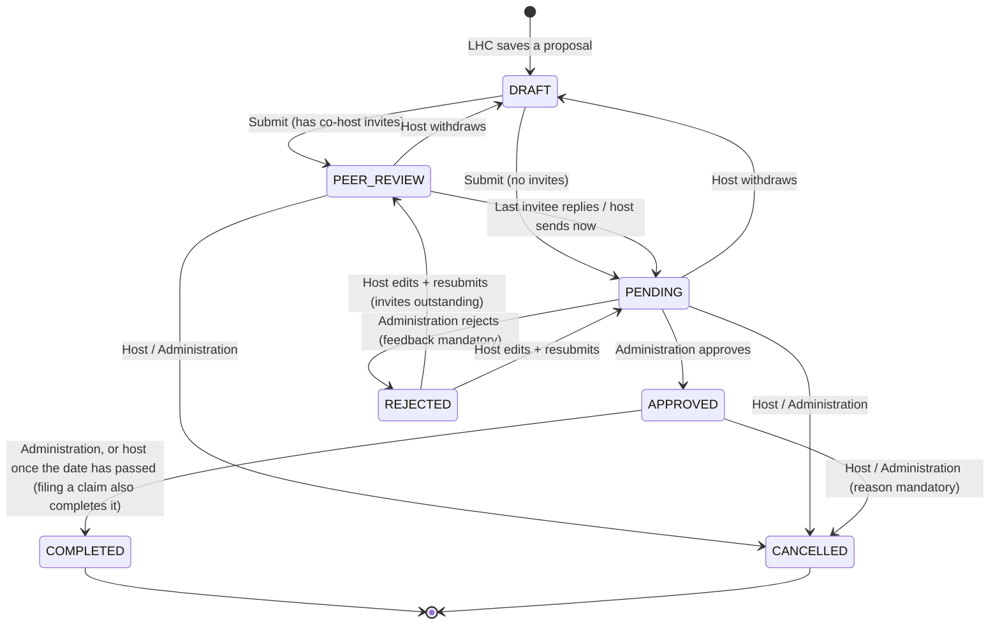

# IITM BS Student Activities — Meetup Approval System
## Comprehensive System Architecture, Role Permissions & Workflow Specification

This document provides the complete structural specification, user hierarchy, permissions matrix, lifecycle workflows, data models, and operational procedures for the **IIT Madras BS Degree Meetup Approval Portal**.

---

## 1. Executive Summary & Purpose

The **IITM BS Meetup Approval Portal** is a student activities governance platform designed to facilitate offline, hybrid, and online student gatherings across India and abroad. 

### Core Objectives
1. **Decentralized Regional Meetup Organization**: Empower Lower House Council (LHC) representatives to organize local meetups for their regional student cohorts.
2. **Cross-House Regional Collaboration**: Allow proposing LHCs to invite and collaborate with fellow LHC members belonging to their **same geographic region**, regardless of house affiliation.
3. **Centralized Institutional Review**: Provide the Administration team with an approval queue to verify safety, logistics, venue feasibility, and policy adherence before any meetup is authorized.
4. **Automated Status Notifications**: Keep proposers and co-hosts notified when a proposal is submitted, peer-accepted, approved, or rejected with feedback.

---

## 2. Institutional Hierarchy & Organizational Structure

The student governance system operates across two orthogonal axes:
- **Vertical Axis (12 Houses)**: Academic, cultural, and mentorship identity.
- **Horizontal Axis (10 Regions)**: Geographic dispersion for local offline interaction.

```
                              ┌────────────────────────────────────────┐
                              │          🏛️ ADMINISTRATION TIER            │
                              │   (Dean, SAC, Activities Council)      │
                              │      Final Approval & Oversight        │
                              └───────────────────┬────────────────────┘
                                                  │ (Central Authority)
                                                  ▼
     ┌────────────────────────────────────────────────────────────────────────────────────────┐
     │                     12 HOUSES (Vertical Student Communities)                           │
     │                                                                                        │
     │   Bandipur    •  Corbett     •  Gir          •  Kanha       •  Kaziranga  •  Nallamala │
     │   Namdapha    •  Nilgiri     •  Pichavaram   •  Saranda     •  Sundarbans •  Wayanad   │
     │                                                                                        │
     │   ┌────────────────────────────────────┐    ┌──────────────────────────────────────┐   │
     │   │      Upper House Council (UHC)     │    │      Lower House Council (LHC)       │   │
     │   │    36 Members (3 per House)        │    │    120 Members (10 per House)        │   │
     │   │   House-level leadership & advice  │    │  Local organizers & event leads      │   │
     │   └────────────────────────────────────┘    └──────────────────┬───────────────────┘   │
     └────────────────────────────────────────────────────────────────┼───────────────────────┘
                                                                      │ (Mapped into)
                                                                      ▼
     ┌────────────────────────────────────────────────────────────────────────────────────────┐
     │                 10 GEOGRAPHIC REGIONS (Horizontal Regional Cohorts)                    │
     │                                                                                        │
     │   • Region 1: Delhi (NCR)                           • Region 6: Kolkata                │
     │   • Region 2: Chennai                               • Region 7: Patna                  │
     │   • Region 3: Bengaluru                             • Region 8: Chandigarh             │
     │   • Region 4: Hyderabad                             • Region 9: Lucknow                │
     │   • Region 5: Mumbai                                • Region 10: International         │
     │                                                                                        │
     │   Every LHC belongs to 1 House AND 1 Region (~12 LHCs per Region across all 12 houses) │
     └────────────────────────────────────────────────────────────────────────────────────────┘
```

### Hierarchy Breakdown & Roster Rules

| Tier | Total Count | House Mapping | Regional Mapping | Operational Scope |
| :--- | :---: | :---: | :---: | :--- |
| **Administration** | Uncapped (Configurable) | Global (All Houses) | Global (All Regions) | Review proposals, grant approvals, reject with mandatory feedback, audit analytics. |
| **Upper House Council (UHC)** | **36 Members** | **12 Houses** &times; 3 each | Global / Cross-regional | House leadership, activity monitoring, advisory oversight, policy guidance. |
| **Lower House Council (LHC)** | **120 Members** | **12 Houses** &times; 10 each | **10 Regions** (~12 each) | Propose local meetups, invite same-region LHC peers, co-host events, represent student peers. |

> [!IMPORTANT]
> **Regional Invitation Invariant**: An LHC member can **only invite LHC peers who share their same geographic region**. Cross-region invitations are restricted to ensure local feasibility and accountability.

---

## 3. Role-Based Access Control (RBAC) & Capabilities


### Administration Role Navigation & Core Modules

The Administration role provides central administration across 4 core views:

1. **🏠 Home (Executive Dashboard)**
   - Executive metrics banner: Pending Approvals count, Approved Meets, Completed Meets, and Pending Reimbursements.
   - Quick action shortcuts to immediately triage incoming proposals or process financial reimbursements.
   - Real-time recent activity stream.

2. **📅 Meetup Hub (Dedicated Lifecycle Registry)**
   - Direct tabbed filters:
     - ⏳ **Pending Approvals**: Proposals requiring decision.
     - ✅ **Approved**: Authorized upcoming gatherings.
     - 🏁 **Completed**: Concluded meetups ready for attendance audit & reimbursement.
     - ❌ **Rejected**: Denied requests with recorded management remarks.
     - (And "All" view with house and regional dropdown filters).
   - Actions:
     - **Review Proposal**: Inspect details, regional peer acceptance rate, and Approve or Reject.
     - **Mark as Completed**: When an approved event concludes, mark it completed to unlock reimbursement claims for the host.

3. **📊 Overall Stats (House & Regional Analytics)**
   - **Meetups Breakdown by House (12 Houses)**: Total meetups proposed, pending, approved, completed, and students engaged per house.
   - **Meetups Breakdown by Region (10 Regions)**: Regional activity index, geographic distribution, and student participation rates.
   - Financial summaries: Total budget claimed vs disbursed across houses and regions.

4. **💰 Reimbursements (Post-Meetup Financial Audit & Disbursement)**
   - Displays all reimbursement claims submitted by LHC hosts for completed meetups.
   - Verification of:
     - Claimed Amount vs Approved Amount.
     - Actual Attendance count with proof notes (e.g., signed roll sheets, QR check-ins, event photos).
     - Itemized bills & vouchers (receipt attachment files).
     - Bank account / UPI ID payout destination.
   - Administration Actions:
     - **✓ Approve Claim**: Authorize payout and enter finance reference / notes.
     - **⏳ Mark In-Progress**: Mark claim as processing with Institute Accounts Office.
     - **✕ Reject Claim**: Provide guidance / rejection remarks.

---

### Detailed Permissions Matrix

| Feature / Action | Administration | Upper House Council (UHC) | Lower House Council (LHC) |
| :--- | :---: | :---: | :---: |
| **Authenticate via Google OAuth / Institutional Email** | ✅ Yes | ✅ Yes | ✅ Yes |
| **View All Approved & Completed Meetups** | ✅ Global | ✅ All | ✅ All |
| **Initiate New Meetup Proposal** | ❌ No | ✅ **Any region** | ✅ **Own region** |
| **Invite Co-hosts** | ❌ N/A | ✅ **Other UHC members** | ✅ **Same-region LHCs** |
| **Accept or Decline Co-host Invitation** | ❌ N/A | ✅ **If Invited** | ✅ **If Invited** |
| **Approve / Reject Meetup Proposals** | ✅ **Sole Authority** | ❌ No | ❌ No |
| **Mark Approved Meetup as Completed** | ✅ **Yes** | 👁️ House level | 👁️ Proposer |
| **Submit Post-Meetup Reimbursement Claim** | ❌ N/A | ✅ **Own meetups** | ✅ **Own meetups** |
| **Save default payout (bank) details** | ❌ N/A | ✅ Yes | ✅ Yes |
| **Audit & Approve Reimbursement Claims** | ✅ **Sole Authority** | 👁️ Read-only | ❌ No |
| **Mark Reimbursement In-Progress (Accounts)** | ✅ **Yes** | ❌ No | ❌ No |
| **View Overall Stats (12 Houses & 10 Regions)** | ✅ **Global Analytics** | ✅ House Analytics | 👁️ Regional |
| **Receive Real-Time Status Notifications** | ✅ Review alerts | 👁️ House alerts | ✅ Status alerts |
| **Database Administration / Seed Reset** | ✅ Allowed | ❌ No | ❌ No |
| **People & access (edit LHC/UHC details, hand over UHC seats, access on/off, CSV/Excel import)** | ✅ **Sole Authority** | ❌ No | ❌ No |

---

## 4. End-to-End Meetup Lifecycle Workflow

### 4.1 Sequence Flow Diagram



### 4.2 Meetup State Transition Diagram



All transitions are enforced server-side in `portal/api/meetups.py` (`permissions()` returns the allowed actions for the signed-in user and the UI renders only those). Every transition writes a row to `meetup_activity`.

### 4.3 Phase-by-Phase Process Explanation

#### Phase 1: Proposing a Meetup (LHC)
1. An LHC representative accesses the portal and clicks **"Propose Meetup"**.
2. **Mandatory Details**:
   - Meetup Title & Comprehensive Agenda / Objectives.
   - Category: *Study Jam & Exam Prep, Hackathon, Project Collaboration, Peer Networking, Alumni Talk, Cultural/Sports*.
   - All meetups are **offline / in person**; a physical venue address is mandatory.
   - Date, Start Time, and End Time.
   - Exact venue address.
   - Preferred date plus an optional backup date.
   - Expected attendance. Budget = ₹200 per expected attendee, plus optional extra budget (with a reason) for large meetups, e.g. venue booking.
3. **Dynamic Regional Peer Discovery**:
   - The system automatically detects the proposer’s assigned Region.
   - It queries all LHCs in that specific region and presents them with:
     - Name and Roll Number.
     - House Tag (colored according to the house palette).
     - Selection checkboxes and a "Select All in Region" shortcut.
4. **Submission**:
   - The proposal is saved as `PEER_REVIEW` if co-hosts were invited, otherwise `PENDING`.
   - Invitation records are created with status `INVITED`.
   - System notifications are dispatched to Administration and the invited peers.

#### Phase 2: Regional Peer Collaboration
1. Invited LHC members receive an in-app notification and an alert badge on the **Peer Invites** sidebar item.
2. In the **Peer Invites** view, invitees can:
   - View the proposing host, venue, date, and objective.
   - Click **"Accept"** to confirm their co-host participation.
   - Click **"Decline"** if unable to attend.
3. Peer responses are reflected in real time on the proposal card and in the Administration review dashboard.

#### Phase 3: Central Administration Review
1. Administration administrators open the **Administration Queue** tab.
2. The review drawer displays:
   - Complete proposal details, schedule, venue, and budget.
   - Proposer profile (Roll number, House, Region).
   - Peer acceptance metrics (e.g., *3 of 4 regional peers accepted*).
3. **Decisions**:
   - **Approve**: Changes status to `APPROVED`. An optional congratulatory note or venue guideline can be appended.
   - **Reject**: Changes status to `REJECTED`. The administrator **must** supply feedback explaining the rejection (e.g., date clash with foundation exams, missing security clearance, insufficient lead time).
4. Automated notifications are sent to the proposing LHC and all confirmed co-hosts.

---

## 5. Data Architecture & Storage Specification

### 5.1 Storage Engine & Location
* **Database**: SQLite at `data/iitmbs_meets.db` (not committed — created and seeded on first run).
* **Schema**: `portal/schema.sql`. `portal/db.py` stores `SCHEMA_VERSION` in `PRAGMA user_version`; an outdated database is rebuilt from seed on startup. Bump the version whenever the schema changes.
* **Uploads**: claim receipts are saved under `data/uploads/` and referenced from `claim_files`.
* **Conventions**: audit timestamps are UTC `YYYY-MM-DD HH:MM:SS`; event dates are `YYYY-MM-DD`, times `HH:MM` (24h); money is whole rupees (`INTEGER`).

### 5.2 Entity Relationship Diagram

```mermaid
erDiagram
    HOUSES ||--o{ USERS : "house_id"
    REGIONS ||--o{ USERS : "region_id"
    USERS ||--o{ MEETUPS : proposes
    MEETUPS ||--o{ MEETUP_INVITATIONS : "co-host invites"
    USERS ||--o{ MEETUP_INVITATIONS : receives
    MEETUPS ||--o{ MEETUP_ACTIVITY : "audit + comments"
    MEETUPS ||--o| CLAIMS : "one claim"
    CLAIMS ||--o{ CLAIM_FILES : receipts
    USERS ||--o{ NOTIFICATIONS : receives

    HOUSES { int id PK; text slug UK; text name; text motto; text color }
    REGIONS { int id PK; text code UK; text name; text states }
    USERS { text id PK; text name; text email UK; text role "ADMINISTRATION|UHC|LHC"; text title; int house_id FK; int region_id FK; text roll_number UK }
    MEETUPS { int id PK; text title; text description; text category; text proposer_id FK; int house_id FK; int region_id FK; text event_date "preferred, then approved"; text backup_date; text start_time; text end_time; text venue "required, offline only"; int expected_attendees; int budget_per_head; int extra_budget; text extra_budget_note; int budget_requested; text status; text review_comments; text reviewed_by FK; text reviewed_at; text submitted_at; text completed_at }
    MEETUP_INVITATIONS { int id PK; int meetup_id FK; text invitee_id FK; text status "INVITED|ACCEPTED|DECLINED"; text response_note; text responded_at }
    MEETUP_ACTIVITY { int id PK; int meetup_id FK; text actor_id FK; text action; text note; text created_at }
    CLAIMS { int id PK; int meetup_id FK_UK; text claimant_id FK; int amount_claimed; int amount_approved; int actual_attendance; text attendance_notes; text expense_notes; text payout_details; text status "PENDING_REVIEW|IN_PROGRESS|APPROVED|REJECTED"; text review_notes }
    CLAIM_FILES { int id PK; int claim_id FK; text original_name; text stored_name; int size_bytes }
    NOTIFICATIONS { int id PK; text user_id FK; text title; text body; int meetup_id FK; int is_read }
```

Database-level guarantees (CHECK constraints): role shape (LHC = house + region, UHC = house only, Administration = neither), `end_time > start_time`, a REJECTED meetup or claim must carry feedback text, one claim per meetup. The same-region invite rule needs a cross-row lookup, so it is enforced in `_sync_invitations()`.

---

## 6. REST API Specifications

Identity comes from a signed session cookie — **no endpoint accepts a user id for the acting user**. Errors are `{"error": "message"}` with a 4xx status.

### Session & reference data
* `GET /api/session` → `{user}` (or `null`). `POST /api/session {user_id}` signs in (demo picker; replace with Google OAuth). `DELETE /api/session` signs out.
* `GET /api/directory?q=` → roster search + featured demo accounts for the sign-in screen.
* `GET /api/meta` → houses, regions, categories, today.

### Dashboards
* `GET /api/home` → role-specific payload (Administration: decision queue, claims, upcoming, to-close; UHC: house counts, region coverage, in review; LHC: invites, to-dos, in-flight, upcoming, region).
* `GET /api/calendar?start=&end=&scope=all|region|house|mine` → meetups in review, approved or held within the date range (home calendar).
* `GET /api/badges` → nav counts. `GET /api/stats?house_id=&region_id=` → totals, by_house, by_region, house×region matrix, by_category, months.

### Meetups
* `GET /api/meetups` — filters: `status` (comma list), `house_id`, `region_id`, `category`, `mine=1`, `invited=1`, `when=upcoming|past`, `q`, `sort=date_asc|submitted`. Results are limited to what the user may see.
* `GET /api/meetups/<id>` → `{meetup, invitations, my_invitation, activity, claim, can}`.
* `GET /api/peers` (LHC/UHC) → people the caller may invite: same-region LHCs for an LHC, other UHC members for a UHC member.
* `POST /api/meetups` (LHC) and `PUT /api/meetups/<id>` (host, DRAFT/REJECTED): `{title, description, category, event_date, backup_date, start_time, end_time, region_id (UHC only), venue, expected_attendees, extra_budget?, extra_budget_note, collab_type, collab_name, collab_about, collab_agenda, collab_contact, collab_sponsored (yes|no), collab_sponsorship, invitee_ids[], submit}` — budget is computed as ₹200 × attendees + extra.`.
* `DELETE /api/meetups/<id>` (host, DRAFT).
* `POST /api/meetups/<id>/submit | send-to-administration | withdraw` (host).
* `POST /api/meetups/<id>/review {decision: APPROVE|REJECT, comments, date_choice: PRIMARY|BACKUP}` (Administration; comments required to reject; BACKUP approves the backup date).
* `POST /api/meetups/<id>/complete` · `POST /api/meetups/<id>/cancel {reason}` · `POST /api/meetups/<id>/comments {body}`.
* `POST /api/invitations/<meetup_id>/respond {decision: ACCEPT|DECLINE, note}` (invitee).

### Claims
* `GET /api/meetups/<id>/claim-setup` (host) → `{per_head, payout (saved details or null), cohosts: [{id, name, house_name, has_details}]}` — co-hosts are accepted invitees from another house.
* `POST /api/attendees/parse` — multipart `file` (.csv or .xlsx, ≤2 MB) → `{attendees: [{name, email}], skipped}`; needs "Name"/"Email" columns (or auto-detected).
* `POST /api/meetups/<id>/claim` — multipart: `attendees` (JSON list of {name, email}), `amount_claimed` (may exceed budget), `expense_notes`, `post_link`, `receipts[]`, `payout_mode` = `SELF` | `OTHER` | `COHOST`, plus bank fields `payee_name, bank_name, account_number, ifsc, upi_id?` (SELF/OTHER; SELF is saved to the profile) or `payee_user_id` (COHOST → status `AWAITING_PAYEE`, co-host notified).
* `POST /api/claims/<id>/payee-response {decision: CONFIRM|DECLINE, note}` (the co-host) — CONFIRM snapshots their saved details → `PENDING_REVIEW`; DECLINE → `PAYEE_DECLINED`.
* `POST /api/claims/<id>/payee` (claimant, while `AWAITING_PAYEE`/`PAYEE_DECLINED`) — choose a different payee (same payout fields as above).
* `GET /api/claims?status=` (Administration: all · UHC: own house + own + paying them · LHC: own + paying them). `GET /api/claims/<id>` adds `attendees`, `files`. Bank fields are blanked (`bank_hidden: true`) unless the viewer is Administration, the payee, or the claimant of a SELF/OTHER claim.
* `POST /api/claims/<id>/review {decision: APPROVE|IN_PROGRESS|REJECT, amount_approved, notes}` (Administration; only `PENDING_REVIEW`/`IN_PROGRESS`).
* `GET /api/claims/<id>/files/<file_id>` — download a receipt.

### Profile & insights
* `GET|PUT|DELETE /api/me/payout` (LHC/UHC) — saved bank details `{account_holder, bank_name, account_number, ifsc, upi_id?}`, used to pre-fill claims.
* `GET /api/insights/house` (UHC) — house totals, rank among houses, per-LHC activity, regional spread, monthly trend.
* `GET /api/insights/me` (LHC) — personal totals, region totals and rank, houses active in the region, regional LHC table.

### People & access (Administration)
* `GET /api/admin/people?role=&q=&house_id=&region_id=&active=` → `{people, counts}`.
* `POST /api/admin/people` `{role, name, email, roll_number, house_id, region_id, title, is_active}` · `PUT /api/admin/people/<id>` (same fields, role fixed).
* `GET /api/admin/people/export.csv` — columns `ID, Role, Name, Email, Roll number, House, Region, Position, Access`.
* `POST /api/admin/people/import` (multipart `file`, .csv/.xlsx) → `{rows: [{line, action: create|update|unchanged|error, changes|error, record, id}], summary}` — nothing written.
* `POST /api/admin/people/import/apply {rows}` — re-validates and applies all-or-nothing.

### Notifications & admin
* `GET /api/notifications` · `POST /api/notifications/read`.
* `POST /api/admin/reset {confirm: "RESET"}` (Administration) — rebuild demo data.

---

## 7. User Interface

* **Code layout**: `templates/index.html` (shell + icon sprite) · `static/css/style.css` (tokens, components, responsive tiers) · `static/js/app.js` (session, hash router, nav, notifications) · `static/js/ui.js` (escaping `html` template tag, formatters, components, dialog/popover/toast) · `static/js/views/*.js` (one module per screen).
* **Routes**: `#/home`, `#/meetups`, `#/meetups/:id`, `#/meetups/:id/edit`, `#/new`, `#/invites` (LHC), `#/claims`, `#/insights`, `#/settings`.
* **Appearance**: themes `light` (warm paper), `dark` (soft graphite, default), `black` (true black) and Auto; seven accent palettes; three typefaces. Chosen in Settings or via ⌘K and stored per device. Status is a glyph whose ring fills as a meetup progresses (draft → with co-hosts → awaiting decision → approved → held).
* **Home calendar**: month grid with approved (solid), in-review (outlined) and held (muted) meetups, plus a day agenda. Scopes: Administration = all; UHC = own house / all; LHC = own region / mine / everywhere.
* **Command palette**: ⌘K / Ctrl+K (search button on phones) — navigate, create, switch theme/accent, search meetups.
* **Layout tiers**: ≥1180px full sidebar · 768–1179px icon rail · <768px top bar + off-canvas drawer + bottom tab bar, dialogs become bottom sheets. No page-level horizontal scroll at any width (wide tables like the heatmap scroll inside their card).

---

## 8. Operational & Testing Guide

### 8.1 Starting the Application
```bash
.venv/bin/python app.py
```
Open **`http://localhost:5050`**.

### 8.2 Standard Test Walkthrough
1. **Sign in as Rahul Verma** (LHC, Sundarbans · Mumbai). *New proposal* → fill the form; the co-host list shows only Mumbai LHCs. Invite Sneha Roy and submit → status *With co-hosts*.
2. **Switch account → Sneha Roy**. Home shows the invite; *Accept*. When the last invitee replies the proposal moves to *Awaiting decision* automatically (or Rahul can *Send to Administration now*).
3. **Switch account → Dr. Meera Krishnan** (Administration). Home → *Decision queue* → open it → *Approve* (or *Reject*, which requires feedback).
4. After the date (or via Administration's *Mark as held*), Rahul files a **reimbursement claim** with receipts from the meetup page; Administration verifies it under *Reimbursements*.
5. **Vikram Rao** (UHC, Sundarbans) sees house activity, region coverage of his LHCs, and can comment on Sundarbans meetups.
