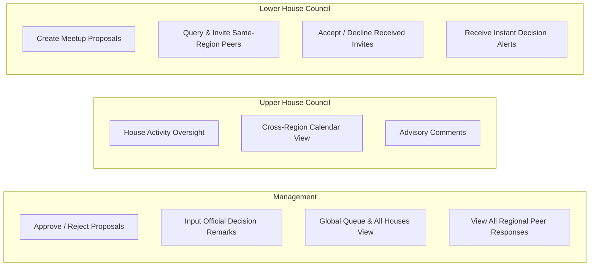
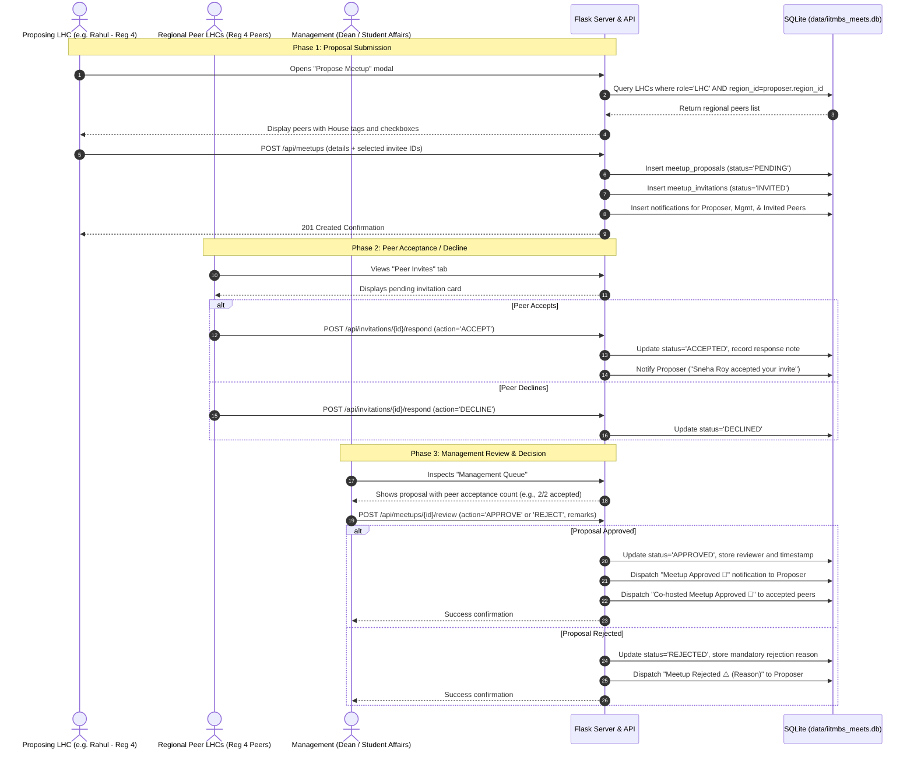
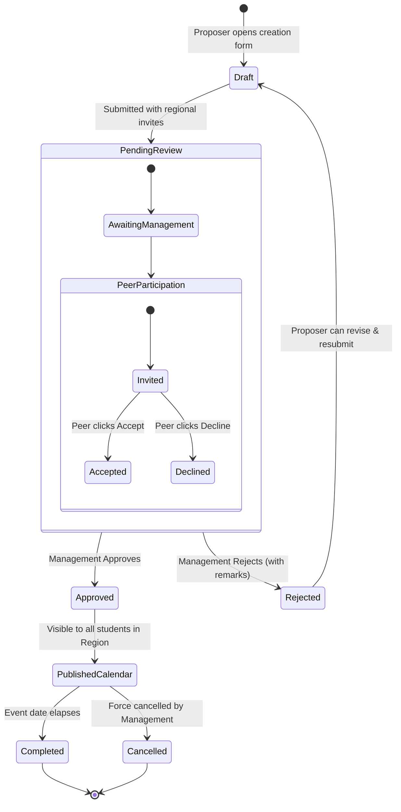
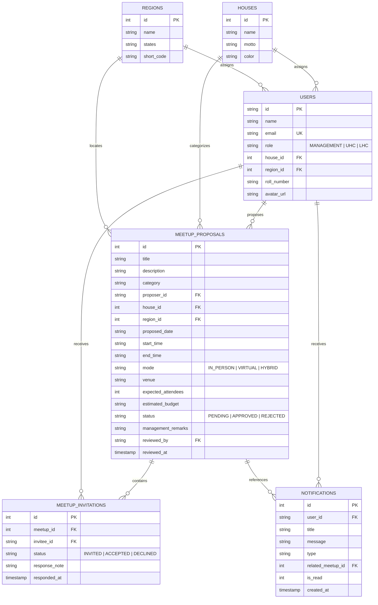

# IITM BS Student Activities — Meetup Approval System
## Comprehensive System Architecture, Role Permissions & Workflow Specification

This document provides the complete structural specification, user hierarchy, permissions matrix, lifecycle workflows, data models, and operational procedures for the **IIT Madras BS Degree Meetup Approval Portal**.

---

## 1. Executive Summary & Purpose

The **IITM BS Meetup Approval Portal** is a student activities governance platform designed to facilitate offline, hybrid, and online student gatherings across India and abroad. 

### Core Objectives
1. **Decentralized Regional Meetup Organization**: Empower Lower House Council (LHC) representatives to organize local meetups for their regional student cohorts.
2. **Cross-House Regional Collaboration**: Allow proposing LHCs to invite and collaborate with fellow LHC members belonging to their **same geographic region**, regardless of house affiliation.
3. **Centralized Institutional Review**: Provide the Management team with an approval queue to verify safety, logistics, venue feasibility, and policy adherence before any meetup is authorized.
4. **Automated Status Notifications**: Keep proposers and co-hosts notified when a proposal is submitted, peer-accepted, approved, or rejected with feedback.

---

## 2. Institutional Hierarchy & Organizational Structure

The student governance system operates across two orthogonal axes:
- **Vertical Axis (12 Houses)**: Academic, cultural, and mentorship identity.
- **Horizontal Axis (10 Regions)**: Geographic dispersion for local offline interaction.

```
                              ┌────────────────────────────────────────┐
                              │          🏛️ MANAGEMENT TIER            │
                              │   (Dean, SAC, Activities Council)      │
                              │      Final Approval & Oversight        │
                              └───────────────────┬────────────────────┘
                                                  │ (Central Authority)
                                                  ▼
     ┌────────────────────────────────────────────────────────────────────────────────────────┐
     │                     12 HOUSES (Vertical Student Communities)                           │
     │                                                                                        │
     │   Bandipur    •  Corbett     •  Gir          •  Kanha       •  Kaziranga  •  Nallamala │
     │   Namdapha    •  Nilgiri     •  Pichavaram   •  Saranda     •  Sundarbans •  Wayanad   │
     │                                                                                        │
     │   ┌────────────────────────────────────┐    ┌──────────────────────────────────────┐   │
     │   │      Upper House Council (UHC)     │    │      Lower House Council (LHC)       │   │
     │   │    36 Members (3 per House)        │    │    120 Members (10 per House)        │   │
     │   │   House-level leadership & advice  │    │  Local organizers & event leads      │   │
     │   └────────────────────────────────────┘    └──────────────────┬───────────────────┘   │
     └────────────────────────────────────────────────────────────────┼───────────────────────┘
                                                                      │ (Mapped into)
                                                                      ▼
     ┌────────────────────────────────────────────────────────────────────────────────────────┐
     │                 10 GEOGRAPHIC REGIONS (Horizontal Regional Cohorts)                    │
     │                                                                                        │
     │   • Region 1: Delhi (NCR)                           • Region 6: Kolkata                │
     │   • Region 2: Chennai                               • Region 7: Patna                  │
     │   • Region 3: Bengaluru                             • Region 8: Chandigarh             │
     │   • Region 4: Hyderabad                             • Region 9: Lucknow                │
     │   • Region 5: Mumbai                                • Region 10: International         │
     │                                                                                        │
     │   Every LHC belongs to 1 House AND 1 Region (~12 LHCs per Region across all 12 houses) │
     └────────────────────────────────────────────────────────────────────────────────────────┘
```

### Hierarchy Breakdown & Roster Rules

| Tier | Total Count | House Mapping | Regional Mapping | Operational Scope |
| :--- | :---: | :---: | :---: | :--- |
| **Management** | Uncapped (Configurable) | Global (All Houses) | Global (All Regions) | Review proposals, grant approvals, reject with mandatory feedback, audit analytics. |
| **Upper House Council (UHC)** | **36 Members** | **12 Houses** &times; 3 each | Global / Cross-regional | House leadership, activity monitoring, advisory oversight, policy guidance. |
| **Lower House Council (LHC)** | **120 Members** | **12 Houses** &times; 10 each | **10 Regions** (~12 each) | Propose local meetups, invite same-region LHC peers, co-host events, represent student peers. |

> [!IMPORTANT]
> **Regional Invitation Invariant**: An LHC member can **only invite LHC peers who share their same geographic region**. Cross-region invitations are restricted to ensure local feasibility and accountability.

---

## 3. Role-Based Access Control (RBAC) & Capabilities



### Management Role Navigation & Core Modules

The Management role provides central administration across 4 core views:

1. **🏠 Home (Executive Dashboard)**
   - Executive metrics banner: Pending Approvals count, Approved Meets, Completed Meets, and Pending Reimbursements.
   - Quick action shortcuts to immediately triage incoming proposals or process financial reimbursements.
   - Real-time recent activity stream.

2. **📅 Meetup Hub (Dedicated Lifecycle Registry)**
   - Direct tabbed filters:
     - ⏳ **Pending Approvals**: Proposals requiring decision.
     - ✅ **Approved**: Authorized upcoming gatherings.
     - 🏁 **Completed**: Concluded meetups ready for attendance audit & reimbursement.
     - ❌ **Rejected**: Denied requests with recorded management remarks.
     - (And "All" view with house and regional dropdown filters).
   - Actions:
     - **Review Proposal**: Inspect details, regional peer acceptance rate, and Approve or Reject.
     - **Mark as Completed**: When an approved event concludes, mark it completed to unlock reimbursement claims for the host.

3. **📊 Overall Stats (House & Regional Analytics)**
   - **Meetups Breakdown by House (12 Houses)**: Total meetups proposed, pending, approved, completed, and students engaged per house.
   - **Meetups Breakdown by Region (10 Regions)**: Regional activity index, geographic distribution, and student participation rates.
   - Financial summaries: Total budget claimed vs disbursed across houses and regions.

4. **💰 Reimbursements (Post-Meetup Financial Audit & Disbursement)**
   - Displays all reimbursement claims submitted by LHC hosts for completed meetups.
   - Verification of:
     - Claimed Amount vs Approved Amount.
     - Actual Attendance count with proof notes (e.g., signed roll sheets, QR check-ins, event photos).
     - Itemized bills & vouchers (receipt attachment files).
     - Bank account / UPI ID payout destination.
   - Management Actions:
     - **✓ Approve Claim**: Authorize payout and enter finance reference / notes.
     - **⏳ Mark In-Progress**: Mark claim as processing with Institute Accounts Office.
     - **✕ Reject Claim**: Provide guidance / rejection remarks.

---

### Detailed Permissions Matrix

| Feature / Action | Management | Upper House Council (UHC) | Lower House Council (LHC) |
| :--- | :---: | :---: | :---: |
| **Authenticate via Google OAuth / Institutional Email** | ✅ Yes | ✅ Yes | ✅ Yes |
| **View All Approved & Completed Meetups** | ✅ Global | ✅ All | ✅ All |
| **Initiate New Meetup Proposal** | ❌ No | 👁️ Co-propose / View | ✅ **Full Authority** |
| **Select & Invite Peer LHCs** | ❌ N/A | ❌ N/A | ✅ **Same Region Only** |
| **Accept or Decline Co-host Invitation** | ❌ N/A | ❌ N/A | ✅ **If Invited** |
| **Approve / Reject Meetup Proposals** | ✅ **Sole Authority** | ❌ No | ❌ No |
| **Mark Approved Meetup as Completed** | ✅ **Yes** | 👁️ House level | 👁️ Proposer |
| **Submit Post-Meetup Reimbursement Claim** | ❌ N/A | ❌ N/A | ✅ **Completed Meetups** |
| **Audit & Approve Reimbursement Claims** | ✅ **Sole Authority** | 👁️ Read-only | ❌ No |
| **Mark Reimbursement In-Progress (Accounts)** | ✅ **Yes** | ❌ No | ❌ No |
| **View Overall Stats (12 Houses & 10 Regions)** | ✅ **Global Analytics** | ✅ House Analytics | 👁️ Regional |
| **Receive Real-Time Status Notifications** | ✅ Review alerts | 👁️ House alerts | ✅ Status alerts |
| **Database Administration / Seed Reset** | ✅ Allowed | ❌ No | ❌ No |

---

## 4. End-to-End Meetup Lifecycle Workflow

### 4.1 Sequence Flow Diagram



### 4.2 Meetup State Transition Diagram



### 4.3 Phase-by-Phase Process Explanation

#### Phase 1: Proposing a Meetup (LHC)
1. An LHC representative accesses the portal and clicks **"Propose Meetup"**.
2. **Mandatory Details**:
   - Meetup Title & Comprehensive Agenda / Objectives.
   - Category: *Study Jam & Exam Prep, Hackathon, Project Collaboration, Peer Networking, Alumni Talk, Cultural/Sports*.
   - Event Mode: *In-Person (Physical Venue), Hybrid (Venue + Live Stream), Virtual (Google Meet / Zoom)*.
   - Date, Start Time, and End Time.
   - Exact Venue address or virtual meeting URL.
   - Target student capacity and estimated budget (if any).
3. **Dynamic Regional Peer Discovery**:
   - The system automatically detects the proposer’s assigned Region.
   - It queries all LHCs in that specific region and presents them with:
     - Name and Roll Number.
     - House Tag (colored according to the house palette).
     - Selection checkboxes and a "Select All in Region" shortcut.
4. **Submission**:
   - The proposal is saved with status `PENDING`.
   - Invitation records are created with status `INVITED`.
   - System notifications are dispatched to Management and the invited peers.

#### Phase 2: Regional Peer Collaboration
1. Invited LHC members receive an in-app notification and an alert badge on the **Peer Invites** sidebar item.
2. In the **Peer Invites** view, invitees can:
   - View the proposing host, venue, date, and objective.
   - Click **"Accept"** to confirm their co-host participation.
   - Click **"Decline"** if unable to attend.
3. Peer responses are reflected in real time on the proposal card and in the Management review dashboard.

#### Phase 3: Central Management Review
1. Management administrators open the **Management Queue** tab.
2. The review drawer displays:
   - Complete proposal details, schedule, venue, and budget.
   - Proposer profile (Roll number, House, Region).
   - Peer acceptance metrics (e.g., *3 of 4 regional peers accepted*).
3. **Decisions**:
   - **Approve**: Changes status to `APPROVED`. An optional congratulatory note or venue guideline can be appended.
   - **Reject**: Changes status to `REJECTED`. The administrator **must** supply feedback explaining the rejection (e.g., date clash with foundation exams, missing security clearance, insufficient lead time).
4. Automated notifications are sent to the proposing LHC and all confirmed co-hosts.

---

## 5. Data Architecture & Storage Specification

### 5.1 Storage Engine & Location
* **Location**: Local SQLite database at:
  📁 `data/iitmbs_meets.db`
* **Driver**: Python's native standard library module (`sqlite3`).
* **Attributes**:
  * **Zero External Dependencies**: Runs out-of-the-box on macOS, Linux, and Windows.
  * **ACID Compliant**: Transactional integrity across multi-step proposal and invitation inserts.
  * **Persistent**: All data survives server restarts, reloads, and browser cache clears.
  * **Production Ready for Migration**: Clean relational schema easily exported to PostgreSQL, Supabase, or SQLite on cloud containers.

### 5.2 Entity Relationship Diagram



---

## 6. REST API Specifications

The Flask backend exposes the following RESTful endpoints:

### Bootstrap & Metadata
* `GET /api/bootstrap`: Returns all 12 houses, 10 regions, curated demo test users, and global counts.
* `POST /api/reset-demo`: Resets the database back to clean seed conditions with 120 LHCs, 36 UHCs, and sample meetups.

### User Management
* `GET /api/users`: Queries users with optional query parameters:
  - `?role=LHC`
  - `?region_id=4`
  - `?house_id=8`
  - `?exclude_id=lhc-8-4`
* `GET /api/user/<user_id>`: Returns full profile including House name, color, and Region information.

### Meetup Lifecycle
* `GET /api/meetups`: Fetches meetups with filtering:
  - `?user_id=<id>`: Attaches personalized invitation status.
  - `?status=PENDING|APPROVED|REJECTED|ALL`
  - `?region_id=<id>`
  - `?house_id=<id>`
* `POST /api/meetups`: Creates a new proposal.
  - Payload: `{ proposer_id, title, description, category, proposed_date, start_time, end_time, mode, venue, expected_attendees, estimated_budget, invitee_ids }`.
* `POST /api/meetups/<id>/review`: Performs Management review.
  - Payload: `{ reviewer_id, action: "APPROVE" | "REJECT", remarks: string }`.

### Regional Invitations & Notifications
* `POST /api/invitations/<id>/respond`: Records peer LHC decision.
  - Payload: `{ user_id, action: "ACCEPT" | "DECLINE", note: string }`.
* `GET /api/notifications?user_id=<id>`: Fetches user notifications.
* `POST /api/notifications/mark-read`: Marks notifications as read.

---

## 7. User Interface Design System

The application strictly reflects the visual identity of the **IIT Madras Student Activities Portal**:

```
┌───────────────────────────────────────────────────────────────────────────────────────┐
│  COLOR PALETTE TOKENS                                                                 │
│  Base Canvas Background:  #16141D (Deep Aubergine Charcoal)                          │
│  Elevated Surface Card:   #201C29 / #282333 (Subtle Slate Tint)                      │
│  Borders & Dividers:      #362F43 / rgba(255, 255, 255, 0.08)                        │
│  Primary Active Accent:   #E05D2D (Warm Terracotta Orange Active Highlight)          │
│  Institutional Crimson:   #800000 (IIT Madras Maroon Accent)                         │
│  Pending Status Badge:    #F59E0B (Amber Gold Glow)                                  │
│  Approved Status Badge:   #10B981 (Emerald Green Glow)                               │
│  Rejected Status Badge:   #EF4444 (Crimson Red Glow)                                 │
└───────────────────────────────────────────────────────────────────────────────────────┘
```

### Visual Components
1. **Persistent Collapsible Sidebar**:
   - Official circular IIT Madras emblem & "Student Activities" branding.
   - Active view indicated by an orange solid pill background (`#E05D2D`).
   - Preferences controls for sidebar position (Left / Right) and expansion mode (Persistent / Hover).
2. **Top Navigation & Role Switcher**:
   - Breadcrumb navigation (`Student Activities / Home`).
   - One-click **Test Role Switcher** buttons to test all roles immediately:
     - `👑 Mgmt`: Dean / Activities Administrator (Dr. Andrew Dean).
     - `🏛️ UHC`: Upper House Council Lead (Vikram - Sundarbans UHC Lead).
     - `✍️ LHC Proposer`: Proposing coordinator (Rahul Verma - Sundarbans House, Mumbai Region).
     - `👥 Regional Peer`: Peer coordinator (Sneha Roy - Corbett House, Mumbai Region).
3. **Interactive Modals**:
   - Propose Meetup Wizard with dynamic regional peer checkboxes.
   - Management Decision modal with approve/reject actions and feedback textarea.
   - Comprehensive meetup detail modal with invitation response roster.

---

## 8. Operational & Testing Guide

### 8.1 Starting the Application
```bash
# Navigate to the workspace
cd /Users/itz_ats_sama/iitmbs-meets

# Activate virtual environment and start server
.venv/bin/python app.py
```
Open **`http://localhost:5050`** in any web browser.

### 8.2 Standard Test Walkthrough

1. **Step 1: Test LHC Proposer Flow**:
   - In the topbar, ensure **`✍️ LHC Proposer`** (Rahul Verma) is active.
   - Click **"Propose Meetup"**.
   - Input title, date, venue, and description.
   - Notice that the peer selector dynamically displays only LHCs in **Region 4 (West)**.
   - Select **Sneha Roy** and **Amit Kulkarni**, then submit.

2. **Step 2: Test Regional Peer Flow**:
   - Click **`👥 Regional Peer`** (Sneha Roy) in the topbar.
   - Open the **"Peer Invites"** tab in the sidebar.
   - Observe the pending invite card. Click **"✓ Accept Invitation"**.

3. **Step 3: Test Management Review Flow**:
   - Click **`👑 Mgmt`** (Dr. Andrew) in the topbar.
   - Open the **"Management Queue"** tab.
   - Click **"Review & Decide"**.
   - Enter feedback remarks and click **"✓ Approve Proposal"** (or **"✕ Reject Proposal"**).

4. **Step 4: Verify Notifications**:
   - Switch back to **`✍️ LHC Proposer`**.
   - Click the 🔔 bell icon in the top right: View the real-time approval notification.
